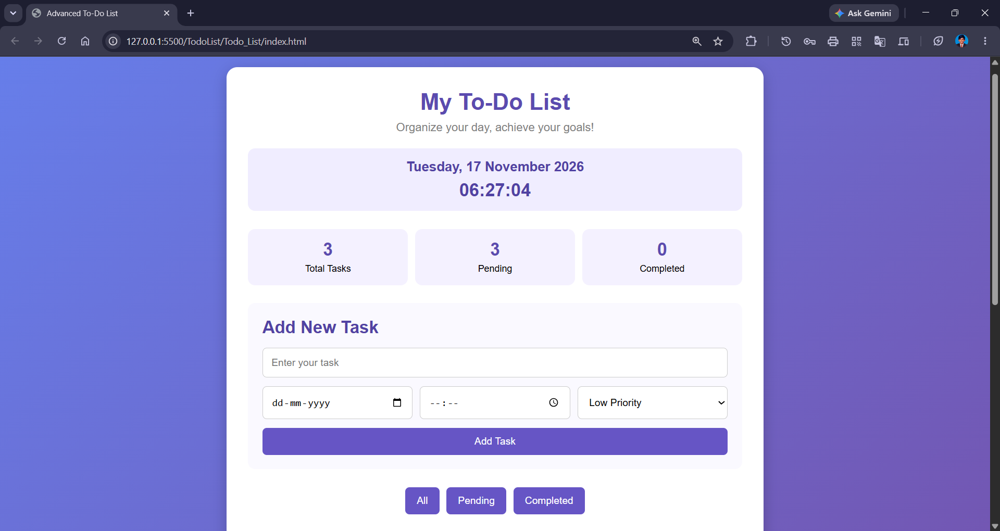
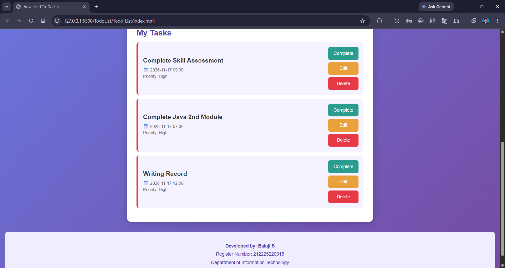

# Ex03 To-Do List using JavaScript
## Date:17-11-2026

## AIM
To create a To-do Application with all features using JavaScript.

## ALGORITHM
### STEP 1
Build the HTML structure (index.html).

### STEP 2
Style the App (style.css).

### STEP 3
Plan the features the To-Do App should have.

### STEP 4
Create a To-do application using Javascript.

### STEP 5
Add functionalities.

### STEP 6
Test the App.

### STEP 7
Open the HTML file in a browser to check layout and functionality.

### STEP 8
Fix styling issues and refine content placement.

### STEP 9
Deploy the website.

### STEP 10
Upload to GitHub Pages for free hosting.

## PROGRAM

### index.html
```html
<!DOCTYPE html>
<html>
<head>
    <title>Advanced To-Do List</title>
    <link rel="stylesheet" href="style.css">
</head>
<body>

    <div class="container">

        <header>
            <h1>My To-Do List</h1>
            <p>Organize your day, achieve your goals!</p>

            <div class="datetime">
                <h3 id="currentDate"></h3>
                <h2 id="currentTime"></h2>
            </div>
        </header>

        <div class="task-summary">
            <div class="box">
                <h2 id="totalTasks">0</h2>
                <p>Total Tasks</p>
            </div>

            <div class="box">
                <h2 id="pendingTasks">0</h2>
                <p>Pending</p>
            </div>

            <div class="box">
                <h2 id="completedTasks">0</h2>
                <p>Completed</p>
            </div>
        </div>

        <div class="task-form">

            <h2>Add New Task</h2>

            <input type="text" id="taskInput"
                   placeholder="Enter your task">

            <div class="form-row">

                <input type="date" id="taskDate">

                <input type="time" id="taskTime">

                <select id="priority">
                    <option value="Low">Low Priority</option>
                    <option value="Medium">Medium Priority</option>
                    <option value="High">High Priority</option>
                </select>

            </div>

            <button onclick="addTask()" id="addButton">
                Add Task
            </button>

        </div>

        <div class="filters">

            <button onclick="filterTasks('All')">All</button>

            <button onclick="filterTasks('Pending')">
                Pending
            </button>

            <button onclick="filterTasks('Completed')">
                Completed
            </button>

        </div>

        <h2 class="list-heading">My Tasks</h2>

        <div id="taskList"></div>

    </div>

    <script src="script.js"></script>
    <footer>
    <hr>
    <p>Developed by: Balaji S</p>
    <p>Register Number: 212225220015</p>
    <p>Department of Information Technology</p>
</footer>

</body>
</html>
```

### style.css

```css
* {
    margin: 0;
    padding: 0;
    box-sizing: border-box;
}

body {
    font-family: Arial, sans-serif;
    background: linear-gradient(135deg, #667eea, #764ba2);
    min-height: 100vh;
    padding: 30px 15px;
}

.container {
    background: white;
    max-width: 750px;
    margin: auto;
    padding: 30px;
    border-radius: 15px;
    box-shadow: 0 5px 20px rgba(0,0,0,0.2);
}

header {
    text-align: center;
    margin-bottom: 25px;
}

header h1 {
    color: #5b4baf;
    font-size: 32px;
}

header p {
    color: gray;
    margin-top: 8px;
}

.datetime {
    background: #f0edff;
    padding: 15px;
    margin-top: 20px;
    border-radius: 10px;
    color: #5142a3;
}

.datetime h2 {
    margin-top: 8px;
    font-size: 25px;
}

.task-summary {
    display: flex;
    justify-content: space-between;
    gap: 10px;
    margin-bottom: 25px;
}

.box {
    background: #f4f1ff;
    flex: 1;
    text-align: center;
    padding: 15px;
    border-radius: 10px;
}

.box h2 {
    color: #5b4baf;
    font-size: 25px;
}

.box p {
    font-size: 13px;
    margin-top: 5px;
}

.task-form {
    background: #faf9ff;
    padding: 20px;
    border-radius: 10px;
}

.task-form h2 {
    color: #5142a3;
    margin-bottom: 15px;
}

input, select {
    width: 100%;
    padding: 12px;
    margin-bottom: 12px;
    border: 1px solid #ccc;
    border-radius: 6px;
    font-size: 14px;
}

.form-row {
    display: flex;
    gap: 10px;
}

button {
    border: none;
    padding: 11px 16px;
    background: #6655c5;
    color: white;
    border-radius: 6px;
    cursor: pointer;
    font-size: 14px;
}

button:hover {
    background: #49389e;
}

#addButton {
    width: 100%;
}

.filters {
    display: flex;
    justify-content: center;
    gap: 10px;
    margin: 25px 0;
}

.list-heading {
    color: #5142a3;
    margin-bottom: 15px;
}

.task {
    background: #f5f3ff;
    border-left: 5px solid #6655c5;
    padding: 15px;
    margin-bottom: 12px;
    border-radius: 8px;
    display: flex;
    justify-content: space-between;
    align-items: center;
    gap: 10px;
}

.task-info {
    flex: 1;
    overflow-wrap: anywhere;
}

.task-info h3 {
    color: #333;
    margin-bottom: 8px;
}

.task-info p {
    font-size: 13px;
    color: #666;
    margin: 4px 0;
}

.task.completed {
    opacity: 0.6;
}

.task.completed h3 {
    text-decoration: line-through;
}

.High {
    border-left-color: #e63946;
}

.Medium {
    border-left-color: #f4a261;
}

.Low {
    border-left-color: #2a9d8f;
}

.overdue {
    color: #d62828 !important;
    font-weight: bold;
}

.actions {
    display: flex;
    flex-direction: column;
    gap: 7px;
}

.complete-btn {
    background: #2a9d8f;
}

.edit-btn {
    background: #e9a23b;
}

.delete-btn {
    background: #e63946;
}

.empty {
    text-align: center;
    color: gray;
    padding: 20px;
}

@media(max-width: 550px) {

    .form-row {
        flex-direction: column;
        gap: 0;
    }

    .task-summary {
        flex-wrap: wrap;
    }

    .box {
        min-width: 28%;
    }

    .task {
        align-items: flex-start;
    }

    .container {
        padding: 18px;
    }
}
footer {
    text-align: center;
    margin-top: 30px;
    padding: 15px;
    color: #5142a3;
    background: #f0edff;
    border-radius: 10px;
    font-size: 14px;
    line-height: 1.8;
}

footer hr {
    border: 0;
    border-top: 1px solid #ccc;
    margin-bottom: 15px;
}

footer p:first-of-type {
    font-weight: bold;
}

```

### script.js
```javascript
let tasks = JSON.parse(localStorage.getItem("tasks")) || [];

let currentFilter = "All";
let editId = null;

// Display current date and time
function updateClock() {

    let now = new Date();

    document.getElementById("currentDate").innerText =
        now.toLocaleDateString("en-IN", {
            weekday: "long",
            year: "numeric",
            month: "long",
            day: "numeric"
        });

    document.getElementById("currentTime").innerText =
        now.toLocaleTimeString();

}

setInterval(updateClock, 1000);
updateClock();


// Add or Update Task
function addTask() {

    let name = document.getElementById("taskInput").value.trim();
    let date = document.getElementById("taskDate").value;
    let time = document.getElementById("taskTime").value;
    let priority = document.getElementById("priority").value;

    if (name === "") {
        alert("Please enter a task!");
        return;
    }

    if (editId !== null) {

        let task = tasks.find(t => t.id === editId);

        task.name = name;
        task.date = date;
        task.time = time;
        task.priority = priority;

        editId = null;

        document.getElementById("addButton").innerText =
            "Add Task";

    } else {

        let newTask = {
            id: Date.now(),
            name: name,
            date: date,
            time: time,
            priority: priority,
            completed: false
        };

        tasks.push(newTask);

    }

    saveTasks();

    document.getElementById("taskInput").value = "";
    document.getElementById("taskDate").value = "";
    document.getElementById("taskTime").value = "";
    document.getElementById("priority").value = "Low";

}


// Save Tasks
function saveTasks() {

    localStorage.setItem("tasks", JSON.stringify(tasks));

    displayTasks();

}


// Display Tasks
function displayTasks() {

    let list = document.getElementById("taskList");

    list.innerHTML = "";

    let filteredTasks = tasks.filter(task => {

        if (currentFilter === "Pending") {
            return !task.completed;
        }

        if (currentFilter === "Completed") {
            return task.completed;
        }

        return true;

    });

    if (filteredTasks.length === 0) {

        list.innerHTML =
            '<p class="empty">No tasks available!</p>';

    }

    filteredTasks.forEach(task => {

        let div = document.createElement("div");

        div.className = "task " + task.priority;

        if (task.completed) {
            div.classList.add("completed");
        }

        let dateTime = task.date ?
            task.date + " " + (task.time || "") :
            "No deadline";

        let isOverdue = false;

        if (task.date && !task.completed) {

            let deadline = new Date(
                task.date + "T" + (task.time || "23:59")
            );

            isOverdue = deadline < new Date();

        }

        div.innerHTML = `
            <div class="task-info">

                <h3></h3>

                <p>📅 ${dateTime}</p>

                <p>Priority: ${task.priority}</p>

                <p class="${isOverdue ? 'overdue' : ''}">
                    ${isOverdue ? '⚠ Overdue' : ''}
                </p>

            </div>

            <div class="actions">

                <button class="complete-btn">
                    ${task.completed ? "Undo" : "Complete"}
                </button>

                <button class="edit-btn">Edit</button>

                <button class="delete-btn">Delete</button>

            </div>
        `;

        div.querySelector("h3").textContent = task.name;

        div.querySelector(".complete-btn").onclick = () =>
            completeTask(task.id);

        div.querySelector(".edit-btn").onclick = () =>
            editTask(task.id);

        div.querySelector(".delete-btn").onclick = () =>
            deleteTask(task.id);

        list.appendChild(div);

    });

    updateSummary();

}


// Complete Task
function completeTask(id) {

    let task = tasks.find(t => t.id === id);

    task.completed = !task.completed;

    saveTasks();

}


// Edit Task
function editTask(id) {

    let task = tasks.find(t => t.id === id);

    document.getElementById("taskInput").value = task.name;
    document.getElementById("taskDate").value = task.date;
    document.getElementById("taskTime").value = task.time;
    document.getElementById("priority").value = task.priority;

    editId = id;

    document.getElementById("addButton").innerText =
        "Update Task";

}


// Delete Task
function deleteTask(id) {

    if (confirm("Are you sure you want to delete this task?")) {

        tasks = tasks.filter(t => t.id !== id);

        saveTasks();

    }

}


// Filter Tasks
function filterTasks(filter) {

    currentFilter = filter;

    displayTasks();

}


// Update Summary
function updateSummary() {

    document.getElementById("totalTasks").innerText =
        tasks.length;

    document.getElementById("pendingTasks").innerText =
        tasks.filter(t => !t.completed).length;

    document.getElementById("completedTasks").innerText =
        tasks.filter(t => t.completed).length;

}


// Initial Display
displayTasks();

```


## OUTPUT


<br>




## RESULT
The program for creating To-do list using JavaScript is executed successfully.
